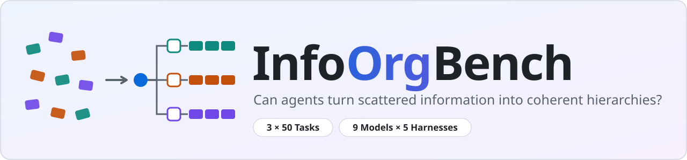
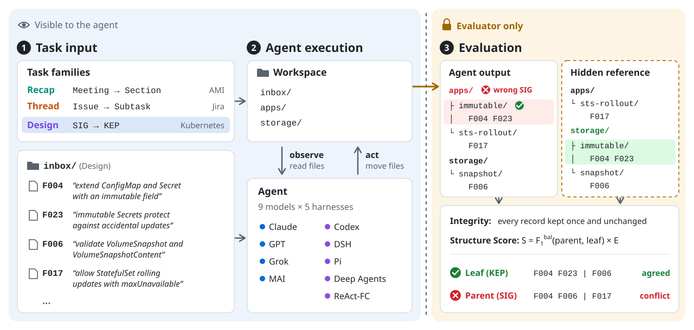
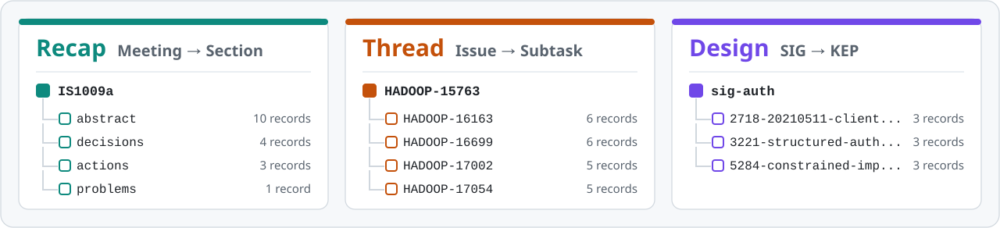
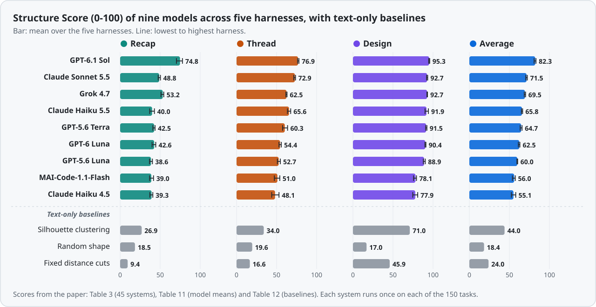
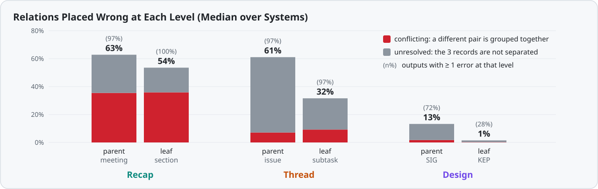

<p align="center">
  <picture>
    <source media="(prefers-color-scheme: dark)" srcset="docs/assets/banner-dark.svg">
    
  </picture>
</p>

<p align="center">
  <a href="https://arxiv.org/abs/2611.10600"></a>
  <a href="docs/DATASHEET.md"></a>
  <a href="#results"></a>
  <a href="LICENSE"></a>
</p>

<p align="center">
  <b>
    <a href="https://arxiv.org/abs/2611.10600">Paper</a> &nbsp;|&nbsp;
    <a href="#overview">Overview</a> &nbsp;|&nbsp;
    <a href="#task-families">Task families</a> &nbsp;|&nbsp;
    <a href="#scoring">Scoring</a> &nbsp;|&nbsp;
    <a href="#results">Results</a> &nbsp;|&nbsp;
    <a href="#key-findings">Key findings</a> &nbsp;|&nbsp;
    <a href="#quick-start">Quick start</a> &nbsp;|&nbsp;
    <a href="#citation">Citation</a>
  </b>
</p>

**InfoOrgBench** tests whether AI agents can turn scattered records, such as
meeting notes, issue threads and excerpts from design documents, into the
folder hierarchy that their sources record. An agent can keep every record and
group related records correctly, yet still file whole groups under the wrong
parent. InfoOrgBench therefore checks separately that every record is kept,
and then scores how well the folders match the source hierarchy at every level.
No language model is used to judge the outputs.

**News.** November 2026: the paper is on arXiv as
[2611.10600](https://arxiv.org/abs/2611.10600). This repository releases the
150 tasks, the scorer, the baselines, the per-task results and final folder
trees of the paper's 45 systems, and the agent harnesses used to run them.

## Overview

<p align="center">
  <picture>
    <source media="(prefers-color-scheme: dark)" srcset="docs/assets/overview-dark.svg">
    
  </picture>
</p>

The agent sees records with opaque IDs and an instruction that says how to
organize them, and it moves the record files into folders. When the agent
stops, the final files are captured and compared with the source hierarchy,
which only the evaluator holds. In the example above, the agent keeps all
excerpts of one Kubernetes Enhancement Proposal (KEP) together but files the
proposal under the wrong owning group, a Kubernetes Special Interest Group
(SIG).

<table>
  <tr>
    <td align="center" width="25%"><h3>150 tasks</h3>in three families</td>
    <td align="center" width="25%"><h3>Hidden answer</h3>the agent never sees it</td>
    <td align="center" width="25%"><h3>Every level scored</h3>with no LLM judge</td>
    <td align="center" width="25%"><h3>45 systems</h3>nine models, five harnesses</td>
  </tr>
</table>

## Task families

<p align="center">
  <picture>
    <source media="(prefers-color-scheme: dark)" srcset="docs/assets/families-dark.svg">
    
  </picture>
</p>

| Family | Records | Hierarchy | Records per task | Groups per task (parents, leaves) | Different parents and leaves overall |
| --- | --- | --- | :---: | :---: | :---: |
| **Recap** | Sentences from AMI meeting summaries | meeting, then summary section | 40 to 60 | 2 to 4 meetings, 6 to 15 sections | 124 meetings, 450 sections |
| **Thread** | Apache Hadoop Jira subtasks and comments | parent issue, then subtask | 41 to 60 | 2 to 3 issues, 3 to 17 subtasks | 3 issues, 42 subtasks |
| **Design** | Excerpts from Kubernetes Enhancement Proposals | owning SIG, then proposal | 36 | 4 SIGs, 12 proposals | 16 SIGs, 294 proposals |

**How the tasks are built.** Each reference is the hierarchy that the source
already records: the meeting and summary section of each AMI sentence, the
parent issue and subtask of each Jira record, and the owning SIG and proposal
of each KEP excerpt. Records receive opaque IDs only after these relations are
fixed. Design excerpts that name their SIG or proposal are left out, so the
agent has to infer the owning group from the content. A SHA-256 hash pins
every task file and reference.

## Scoring

- **Integrity.** Every record must end up in exactly one folder with its bytes
  unchanged. An output that loses, duplicates or edits a record scores 0.
- **Structure Score.** For any three records, the source hierarchy says which
  two of them belong closer together. The score counts how often the output
  agrees, separately for relations between parent groups and for relations
  inside a parent. Precision and recall are averaged over these two levels and
  combined into a level-balanced F1. Folder names and the order of folders do
  not matter.
- **Folder economy.** The F1 is multiplied by a factor
  E = 1 − 0.2 × (extra single-child folders) / (folders in the output), which
  lowers the score when an output wraps groups in folders that hold only one
  item.

The paper also reports the pooled Triplet F1 and the folder-economy penalty,
100 × (1 − E). All scores are on a scale from 0 to 100.

## Results

<p align="center">
  <picture>
    <source media="(prefers-color-scheme: dark)" srcset="docs/assets/results-dark.svg">
    
  </picture>
</p>

Each model was run with five harnesses: ReAct-FC (our own function-calling
agent loop), OpenAI Codex CLI, DeepSeek Harness (DSH), Pi and LangChain Deep
Agents. The family columns give each model's average Structure Score over the
five harnesses, and the last two columns show how much the harness changes it.
The three baselines in italics use no language model: they cluster the records
by word overlap (TF-IDF similarity).

| Model | Recap | Thread | Design | Average | Lowest to highest harness | Best harness |
| --- | ---: | ---: | ---: | ---: | :---: | --- |
| GPT-6.1 Sol | **74.8** | **76.9** | **95.3** | **82.3** | 80.9 to 83.2 | DSH (83.2) |
| Claude Sonnet 5.5 | 48.8 | 72.9 | 92.7 | 71.5 | 70.5 to 72.4 | Deep Agents (72.4) |
| Grok 4.7 | 53.2 | 62.5 | 92.7 | 69.5 | 68.6 to 70.2 | DSH (70.2) |
| Claude Haiku 5.5 | 40.0 | 65.6 | 91.9 | 65.8 | 65.0 to 66.5 | Deep Agents (66.5) |
| GPT-5.6 Terra | 42.5 | 60.3 | 91.5 | 64.7 | 63.5 to 65.8 | Pi (65.8) |
| GPT-6 Luna | 42.6 | 54.4 | 90.4 | 62.5 | 61.2 to 63.1 | Deep Agents (63.1) |
| GPT-5.6 Luna | 38.6 | 52.7 | 88.9 | 60.0 | 59.4 to 60.3 | Pi (60.3) |
| MAI-Code-1.1-Flash | 39.0 | 51.0 | 78.1 | 56.0 | 53.8 to 57.3 | Pi (57.3) |
| Claude Haiku 4.5 | 39.3 | 48.1 | 77.9 | 55.1 | 52.5 to 57.9 | Pi (57.9) |
| *Silhouette clustering* | 26.9 | 34.0 | 71.0 | 44.0 | | |
| *Random shape* | 18.5 | 19.6 | 17.0 | 18.4 | | |
| *Fixed distance cuts* | 9.4 | 16.6 | 45.9 | 24.0 | | |

Per-task scores and run settings of all 45 systems are in [results/](results).
Running `python results/check_table3.py` recomputes every cell of the paper's
main results table from them.

<details>
<summary><b>All 45 systems</b> (Structure Score per family, with the average pooled Triplet F1 and folder-economy penalty)</summary>

| Model | Harness | Recap | Thread | Design | Average | Avg. Triplet F1 | Avg. penalty |
| --- | --- | ---: | ---: | ---: | ---: | ---: | ---: |
| GPT-6.1 Sol | ReAct-FC | 74.1 | **77.9** | **95.8** | 82.6 | 83.7 | 0.5 |
| GPT-6.1 Sol | Pi | 75.5 | 76.5 | 95.6 | 82.5 | 83.4 | 0.5 |
| GPT-6.1 Sol | Deep Agents | 76.3 | 76.3 | 94.6 | 82.4 | 83.0 | 0.6 |
| GPT-6.1 Sol | DSH | **77.8** | 76.6 | 95.2 | **83.2** | 83.9 | 0.5 |
| GPT-6.1 Sol | Codex | 70.3 | 77.2 | 95.4 | 80.9 | 81.7 | 0.5 |
| Claude Sonnet 5.5 | ReAct-FC | 48.5 | 73.5 | 92.9 | 71.6 | 71.7 | 0.9 |
| Claude Sonnet 5.5 | Pi | 48.9 | 73.6 | 92.7 | 71.7 | 71.5 | 0.8 |
| Claude Sonnet 5.5 | Deep Agents | 50.3 | 73.5 | 93.3 | 72.4 | 72.6 | 0.7 |
| Claude Sonnet 5.5 | DSH | 48.9 | 72.4 | 92.0 | 71.1 | 70.8 | 0.9 |
| Claude Sonnet 5.5 | Codex | 47.5 | 71.5 | 92.6 | 70.5 | 70.0 | 0.9 |
| Grok 4.7 | ReAct-FC | 51.0 | 62.2 | 92.6 | 68.6 | 67.2 | 3.5 |
| Grok 4.7 | Pi | 53.2 | 62.9 | 93.1 | 69.7 | 68.2 | 3.3 |
| Grok 4.7 | Deep Agents | 53.2 | 62.8 | 92.4 | 69.5 | 68.1 | 3.6 |
| Grok 4.7 | DSH | 54.5 | 63.0 | 92.9 | 70.2 | 68.6 | 3.2 |
| Grok 4.7 | Codex | 54.3 | 61.6 | 92.6 | 69.5 | 68.0 | 3.6 |
| Claude Haiku 5.5 | ReAct-FC | 39.9 | 65.1 | 90.0 | 65.0 | 64.0 | 2.1 |
| Claude Haiku 5.5 | Pi | 36.9 | 66.8 | 92.0 | 65.3 | 64.4 | 1.2 |
| Claude Haiku 5.5 | Deep Agents | 40.2 | 67.6 | 91.9 | 66.5 | 65.8 | 1.3 |
| Claude Haiku 5.5 | DSH | 42.8 | 63.6 | 91.2 | 65.9 | 63.1 | 1.3 |
| Claude Haiku 5.5 | Codex | 40.1 | 64.8 | 94.2 | 66.3 | 65.2 | 1.3 |
| GPT-5.6 Terra | ReAct-FC | 43.6 | 57.5 | 92.3 | 64.5 | 62.8 | 3.5 |
| GPT-5.6 Terra | Pi | 42.9 | 63.7 | 90.8 | 65.8 | 64.0 | 2.3 |
| GPT-5.6 Terra | Deep Agents | 43.5 | 62.3 | 90.9 | 65.6 | 64.4 | 2.5 |
| GPT-5.6 Terra | DSH | 40.9 | 58.3 | 91.4 | 63.5 | 62.1 | 3.1 |
| GPT-5.6 Terra | Codex | 41.6 | 59.6 | 92.0 | 64.4 | 63.2 | 3.0 |
| GPT-6 Luna | ReAct-FC | 39.9 | 53.7 | 89.9 | 61.2 | 59.4 | 4.0 |
| GPT-6 Luna | Pi | 42.3 | 55.3 | 90.5 | 62.7 | 60.4 | 3.8 |
| GPT-6 Luna | Deep Agents | 42.3 | 55.9 | 91.1 | 63.1 | 61.0 | 3.7 |
| GPT-6 Luna | DSH | 43.8 | 53.0 | 90.4 | 62.4 | 60.0 | 3.9 |
| GPT-6 Luna | Codex | 44.5 | 54.2 | 90.2 | 63.0 | 65.3 | 3.9 |
| GPT-5.6 Luna | ReAct-FC | 37.0 | 51.0 | 90.3 | 59.4 | 57.1 | 4.4 |
| GPT-5.6 Luna | Pi | 36.7 | 54.7 | 89.4 | 60.3 | 57.9 | 3.6 |
| GPT-5.6 Luna | Deep Agents | 38.5 | 53.9 | 88.6 | 60.3 | 58.1 | 3.5 |
| GPT-5.6 Luna | DSH | 40.3 | 51.5 | 87.9 | 59.9 | 57.3 | 4.3 |
| GPT-5.6 Luna | Codex | 40.3 | 52.2 | 88.2 | 60.2 | 57.1 | 4.2 |
| MAI-Code-1.1-Flash | ReAct-FC | 41.7 | 47.2 | 79.3 | 56.1 | 53.9 | 3.2 |
| MAI-Code-1.1-Flash | Pi | 39.8 | 54.0 | 78.0 | 57.3 | 55.9 | 3.8 |
| MAI-Code-1.1-Flash | Deep Agents | 37.6 | 53.1 | 78.3 | 56.3 | 54.7 | 3.8 |
| MAI-Code-1.1-Flash | DSH | 38.9 | 51.9 | 79.3 | 56.7 | 54.0 | 4.3 |
| MAI-Code-1.1-Flash | Codex | 36.8 | 49.0 | 75.7 | 53.8 | 52.3 | 4.3 |
| Claude Haiku 4.5 | ReAct-FC | 40.8 | 46.2 | 79.9 | 55.6 | 52.2 | 4.5 |
| Claude Haiku 4.5 | Pi | 39.8 | 53.0 | 80.9 | 57.9 | 55.4 | 3.6 |
| Claude Haiku 4.5 | Deep Agents | 40.2 | 50.7 | 79.0 | 56.7 | 53.4 | 4.1 |
| Claude Haiku 4.5 | DSH | 37.1 | 46.8 | 74.7 | 52.9 | 47.6 | 7.7 |
| Claude Haiku 4.5 | Codex | 38.7 | 43.9 | 74.9 | 52.5 | 49.3 | 4.5 |

All models use medium reasoning effort, except Claude Haiku 4.5, which uses its
provider's default setting. Each system ran once on every task.

</details>

## Key findings

- **No system recovers the hierarchy reliably.** The best system, GPT-6.1 Sol
  with DSH, averages 83.2 out of 100. No system scores above 78 on Recap or
  Thread, although the best system reaches 95.8 on Design.
- **The model matters far more than the harness.** The average scores of the
  nine models are up to 27.2 points apart. Changing the harness moves the
  average score by less than one point (from −0.7 to +0.6), which is about as
  much as the scores vary between two identical runs.
- **Most errors happen above the leaf level.** In every family, relations
  between parent groups go wrong more often than relations inside a group, as
  the figure below shows.
  - *Recap:* agents group notes by topic rather than by meeting, so 54% of the
    output folders mix notes from different meetings.
  - *Thread:* half of the outputs leave out the parent-issue level.
  - *Design:* agents recover 96% of the proposal groups, yet 596 of 1,250
    outputs keep every proposal together but file some under the wrong SIG.
- **More computation did not help in our test.** For GPT-5.6 Terra with Codex,
  higher reasoning effort changed the average score by −1.0 points, and
  combining three runs without looking at the reference changed it by −0.2 to
  +0.5 points.
- **Exact matches are rare.** GPT-6.1 Sol with ReAct-FC reproduces the complete
  reference hierarchy in only 1 Recap task and 2 Thread tasks out of 50 each.

<p align="center">
  <picture>
    <source media="(prefers-color-scheme: dark)" srcset="docs/assets/errors-dark.svg">
    
  </picture>
</p>

## Quick start

You need Python 3.11 or newer and Git. The benchmark tools use only the
standard library, so there is nothing else to install; the agent you evaluate
is installed separately. Every command below works in bash and in PowerShell.

### 1. Get the code

```bash
git clone https://github.com/microsoft/InfoOrgBench.git
cd InfoOrgBench/benchmark
python run_task.py list
```

`list` shows the 50 tasks of each family. Recap and Design tasks are ready to
use. Thread tasks need one extra step first: saving 42 public Jira issues by
hand ([step 4](#4-build-the-thread-tasks)).

### 2. Run one task end to end

**a. Prepare a run folder.** Put it outside the repository, so that the agent
does not come across the reference files. This is not a sandbox: an agent with
shell access can still read other files on your machine.

```bash
python run_task.py prepare Recap/mini-001 ../../runs/recap-001
```

```text
runs/recap-001/
├── TASK.md               instruction for the agent, worded as in the paper
├── check_inventory.py    integrity check the agent can run (no answers inside)
├── task.json             task ID and record hashes, used for scoring
└── workspace/inbox/      F001.txt ... F051.txt, one file per record
```

**b. Let an agent organize the records.** Start any agent that can read and
move files in `workspace/`, and give it the instructions in `TASK.md`. For
example, with the [GitHub Copilot CLI](https://github.com/github/copilot-cli):

```bash
cd ../../runs/recap-001/workspace
copilot --add-dir .. --allow-all-tools -p "Follow the instructions in ../TASK.md"
cd ../../../InfoOrgBench/benchmark
```

Any other agent works the same way. To try the steps without an agent, move a
few files into folders by hand.

**c. Check the workspace** (optional). This reports records that are missing,
changed or still in the inbox, without judging where they were placed:

```bash
python run_task.py check ../../runs/recap-001
```

**d. Score it.**

```bash
python run_task.py score ../../runs/recap-001
```

The example output below comes from the released GPT-6.1 Sol output for this
task; your agent's score will differ:

```text
Task Recap/mini-001: valid output
  Structure Score        81.9
  Pooled triplet F1      84.0
  Folder-economy penalty 0.0
  Parent-level recall    83.5
  Leaf-level recall      80.4
  Records left in inbox  0
Saved ../../runs/recap-001/result.json
```

`result.json` keeps the scores, and `output.json` keeps the captured folder
tree.

### 3. Evaluate an agent on a whole family

A task pattern such as `"Design/*"` creates one run folder for each task. Run
your agent in each `workspace/`, then score the runs and average them:

```bash
python run_task.py prepare "Design/*" ../../runs/design
python run_task.py score "../../runs/design/*"
python run_task.py summary "../../runs/design/*"
```

The script expands the quoted wildcards itself, so the same commands work in
every shell. In the paper, a family score is the average over all 50 tasks of
that family, and the overall average is the mean of the three family scores.

### 4. Build the Thread tasks

The Jira text is not redistributed here. Open the 42 links in
[docs/THREAD-DATA.md](docs/THREAD-DATA.md) in a browser and save each page
under the file name shown, all in one folder (for example
`../../thread-responses`). Then build the 50 Thread tasks:

```bash
python build_thread.py --responses ../../thread-responses
```

### 5. Reproduce the saved scores

`replay.py` scores all 1,700 saved outputs again, offline, and checks every
metric against [benchmark/saved-results.json](benchmark/saved-results.json) to
a tolerance of 1e-12:

```bash
python -I -S -B replay.py --receipt replay-receipt.json
```

It prints nothing until it finishes, which takes about 30 minutes for all
1,700 outputs, and then prints a receipt like this (shortened):

```json
{"passed": true, "outputs_replayed": 1700, "tasks": 150, "lambda_checks": 8500,
 "metric_tolerance": 1e-12, "network_and_subprocesses_denied": true}
```

If the Thread tasks have not been built, it checks the 900 Recap and Design
outputs and skips the 800 Thread outputs. Add `--require-thread` to make it fail
instead of skipping.

### 6. Rerun a system from the paper

[harness/](harness) contains the paper's five harnesses (ReAct-FC, Codex CLI,
Pi, DeepSeek Harness and Deep Agents) with the same prompts, tools and settings.
The models are reached through your own GitHub Copilot plan or a provider API
key, and the [harness guide](harness/README.md) explains installation and
setup. From the repository root:

```bash
python -m pip install -e harness
python -m infoorgbench_harness run --harness react-fc --model gpt-6.1-sol --backend copilot --family Recap --tasks mini-001 --out ../runs/reactfc-sol
python -m infoorgbench_harness score --run ../runs/reactfc-sol --out ../runs/reactfc-sol/scores.json
```

A rerun produces a new sample, so its scores will differ somewhat from the
published ones.

## What's in this repository

The 1,700 saved outputs in [benchmark/predictions/](benchmark/predictions) are
final folder trees that `replay.py` scores again:

| Outputs | What they are | Model and harness |
| ---: | --- | --- |
| 1,200 | Baselines without a language model, on every family: all records in one folder, fixed distance cuts and silhouette clustering (50 tasks each), and random trees of the silhouette shape with five seeds (250) | None |
| 300 | Thread checks: silhouette clustering (50) and random trees (250) after masking issue keys and other identifiers | None |
| 100 | Recap and Thread, 50 tasks each | Claude Haiku 4.5 with ReAct-FC |
| 100 | Recap and Thread, 50 tasks each | GPT-6.1 Sol with ReAct-FC |

The results of all 45 systems are released as well:

- [results/](results) holds the per-task scores and run settings, and
  `check_table3.py`, which reproduces the paper's main results table.
- [results/assignments/](results/assignments) holds the final folder trees of
  5,368 of the 6,750 outputs of the 45 systems, and `results/rescore.py` scores
  each of them again against `results/per-task.csv`. The remaining outputs
  were not kept; [results/assignments/README.md](results/assignments/README.md)
  lists them and explains why.
- [harness/](harness) holds the agent harnesses and prompts used for these runs.

Model outputs contain only the final folder path of each record ID, including
the folder names that the model chose. In Thread, folder names that copied six
or more consecutive words of Jira text were replaced with neutral names; this
does not change any score. Transcripts, tool-call logs and token counts are not
included.

<details>
<summary><b>Repository layout</b></summary>

| Path | Contents |
| --- | --- |
| [benchmark/run_task.py](benchmark/run_task.py) | Prepares, checks, scores and summarizes runs of any agent |
| [benchmark/inputs/public/](benchmark/inputs/public) | The task files given to agents: 50 Recap and 50 Design tasks (Thread tasks are built locally) |
| [benchmark/inputs/reference/](benchmark/inputs/reference) | Reference hierarchies for all 150 tasks, with record IDs, source IDs and hashes but no record text |
| [benchmark/build_thread.py](benchmark/build_thread.py), [benchmark/sources/hadoop-jira/](benchmark/sources/hadoop-jira) | The list of Jira issues and the script that builds the Thread tasks |
| [benchmark/predictions/](benchmark/predictions) | The 1,700 saved outputs |
| [benchmark/saved-results.json](benchmark/saved-results.json) | The expected scores of every saved output |
| [benchmark/engine/](benchmark/engine) | The scorer |
| [benchmark/algorithm-source/](benchmark/algorithm-source) | The baselines and their fixed settings |
| [benchmark/replay.py](benchmark/replay.py), [benchmark/manifest.json](benchmark/manifest.json) | The offline replay, and the SHA-256 of every file it reads |
| [results/](results) | Per-task scores and run settings of the 45 systems, and a script that reproduces the main results table |
| [results/assignments/](results/assignments), [results/rescore.py](results/rescore.py) | Final folder trees of 5,368 of the 6,750 outputs, and a script that scores them again |
| [harness/](harness) | ReAct-FC and the adapters for Codex CLI, Pi, DeepSeek Harness and Deep Agents |
| [docs/DATASHEET.md](docs/DATASHEET.md) | Documentation of the dataset |
| [docs/THREAD-DATA.md](docs/THREAD-DATA.md) | How to download the Jira issues and build the Thread tasks |
| [docs/assets/](docs/assets) | The README figures, the paper's result numbers and the script that draws the figures |
| [tools/](tools) | Checks run before each release |

Regenerating the baselines also needs the packages listed in
[benchmark/requirements-paper-pilot.txt](benchmark/requirements-paper-pilot.txt).

</details>

<details>
<summary><b>How InfoOrgBench differs from other benchmarks</b></summary>

| Benchmark | Tasks | Agent actions | Works on files | Needs no virtual machine or service | Organizes many items | Reference existed before the benchmark | Scored without a language model |
| --- | ---: | --- | :---: | :---: | :---: | :---: | :---: |
| WebArena | 812 | Click, type | ✗ | ✗ | ✗ | ✗ | ✗ |
| OSWorld | 369 | Mouse, keys | ✗ | ✗ | ✗ | ✗ | ✓ |
| SWE-bench | 2,294 | Write patch | ✓ | ✗ | ✗ | ✓ | ✓ |
| Workspace-Bench | 388 | Shell, files | ✓ | ✗ | ✗ | ✗ | ✗ |
| HSCodeComp | 632 | Search | ✗ | ✓ | ✗ | ✗ | ✓ |
| TExEval-2 | 24 | None | ✗ | ✓ | ✓ | ✓ | ✓ |
| **InfoOrgBench** | 150 | Read, search, move | ✓ | ✓ | ✓ | ✓ | ✓ |

</details>

## Licensing

| Material | Licence |
| --- | --- |
| Code (`benchmark/engine`, `benchmark/algorithm-source`, `benchmark/*.py`, `harness`, `results/*.py`, `tools`, `tests`, `docs/assets`) | MIT; see [LICENSE](LICENSE). Separately installed harness runtimes keep their own terms. |
| References, baseline and model outputs, results, metrics and metadata authored for InfoOrgBench | MIT; see [LICENSE](LICENSE) |
| Recap record text from the AMI Meeting Corpus (`benchmark/inputs/public/Recap/`) | CC BY 4.0 ([licence](https://creativecommons.org/licenses/by/4.0/)); © AMI Consortium |
| Design record text from Kubernetes Enhancement Proposals (`benchmark/inputs/public/Design/`) | Apache-2.0; © The Kubernetes Authors |
| Thread record text from the Apache Hadoop issue tracker | Not included. You download it from [Apache Jira](https://issues.apache.org/jira/projects/HADOOP) under the terms that apply there. |

Each source keeps its original licence, which the MIT licence does not replace.
[NOTICE.md](NOTICE.md) gives each source's origin and attribution, the changes
we made and the full licence text.

## Intended use and limitations

- InfoOrgBench is meant for evaluating agents and harnesses on organizing
  records into a hierarchy while keeping every record unchanged.
- The scores measure agreement with the hierarchy recorded in the sources.
  Other ways of organizing the same records can also be useful to people.
- The 150 English tasks are development tasks without a held-out split, and
  tasks in the same family reuse source material; all Thread tasks draw on the
  same three parent issues. Rankings on these tasks do not by themselves show
  that one system is better on new sources.
- All sources are public and may have appeared in model training data.
- Each system ran once on each task, and differences of about one point are
  within the variation between repeated runs.
- A rerun with [harness/](harness) produces a new sample. Only the connection
  to the model provider differs from the paper's runs.

## Citation

If you use InfoOrgBench, please cite the paper:

```bibtex
@misc{ou2026infoorgbench,
  title         = {InfoOrgBench: Can Agents Turn Scattered Information into Coherent Hierarchies?},
  author        = {Ou, Justice and Ma, Lanming and Zhang, Zijian and Zhao, Yilun},
  year          = {2026},
  eprint        = {2611.10600},
  archivePrefix = {arXiv},
  primaryClass  = {cs.AI},
  url           = {https://arxiv.org/abs/2611.10600}
}
```

## Contributing

This project welcomes contributions and suggestions. Most contributions
require you to agree to a Contributor License Agreement (CLA) declaring that
you have the right to, and actually do, grant us the rights to use your
contribution. For details, visit <https://cla.opensource.microsoft.com>. See
[CONTRIBUTING.md](CONTRIBUTING.md).

When you submit a pull request, a CLA bot will automatically determine whether
you need to provide a CLA and decorate the PR appropriately (e.g., status
check, comment). Simply follow the instructions provided by the bot. You will
only need to do this once across all repos using our CLA.

This project has adopted the
[Microsoft Open Source Code of Conduct](https://opensource.microsoft.com/codeofconduct/).
For more information see the
[Code of Conduct FAQ](https://opensource.microsoft.com/codeofconduct/faq/) or
contact [opencode@microsoft.com](mailto:opencode@microsoft.com) with any
additional questions or comments.

## Security

Please do not report security vulnerabilities through public GitHub issues.
See [SECURITY.md](SECURITY.md) for how to report them to the Microsoft
Security Response Center (MSRC).

## Trademarks

This project may contain trademarks or logos for projects, products, or
services. Authorized use of Microsoft trademarks or logos is subject to and
must follow
[Microsoft's Trademark & Brand Guidelines](https://www.microsoft.com/legal/intellectualproperty/trademarks/usage/general).
Use of Microsoft trademarks or logos in modified versions of this project must
not cause confusion or imply Microsoft sponsorship. Any use of third-party
trademarks or logos are subject to those third-party's policies.

<p align="right"><a href="#overview">Back to overview ↑</a></p>
