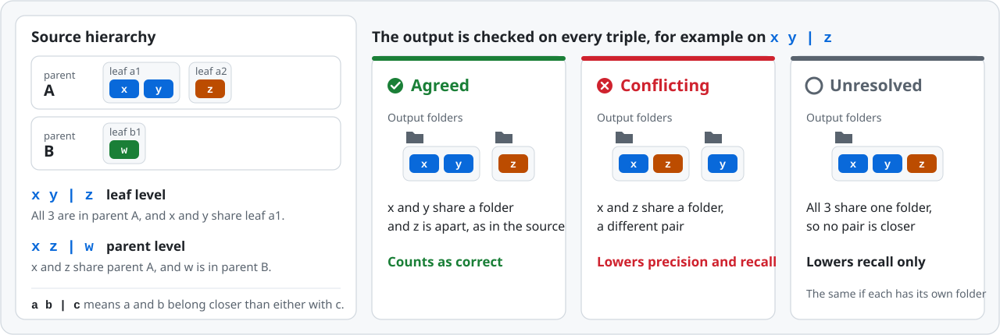

<p align="center">
  <picture>
    <source media="(prefers-color-scheme: dark)" srcset="docs/assets/banner-dark.svg">
    
  </picture>
</p>

<p align="center">
  <a href="https://arxiv.org/abs/2611.10600"></a>
  <a href="docs/DATASHEET.md"></a>
  <a href="#results"></a>
  <a href="LICENSE"></a>
</p>

<p align="center">
  <b>
    <a href="https://arxiv.org/abs/2611.10600">Paper</a> &nbsp;|&nbsp;
    <a href="#overview">Overview</a> &nbsp;|&nbsp;
    <a href="#task-families">Task families</a> &nbsp;|&nbsp;
    <a href="#scoring">Scoring</a> &nbsp;|&nbsp;
    <a href="#results">Results</a> &nbsp;|&nbsp;
    <a href="#key-findings">Key findings</a> &nbsp;|&nbsp;
    <a href="#quick-start">Quick start</a> &nbsp;|&nbsp;
    <a href="#do-agent-skills-help">Skills eval</a> &nbsp;|&nbsp;
    <a href="#citation">Citation</a>
  </b>
</p>

**InfoOrgBench** tests whether AI agents can turn scattered records, such as
meeting notes, issue threads and excerpts from design documents, into the
folder hierarchy that their sources record. An agent can keep every record and
group related records correctly, yet still file whole groups under the wrong
parent. InfoOrgBench therefore checks separately that every record is kept,
and then scores how well the folders match the source hierarchy at every level.
No language model is used to judge the outputs.

🔥 **News, Nov 2026:** We put the 5 most popular organizing Agent Skills to the
test, and none of them helped agents organize better!
[Check out the Skills eval →](#do-agent-skills-help)

## Overview

<p align="center">
  <picture>
    <source media="(prefers-color-scheme: dark)" srcset="docs/assets/overview-dark.svg">
    
  </picture>
</p>

The agent sees records with opaque IDs and an instruction that says how to
organize them, and it moves the record files into folders. When the agent
stops, the final files are captured and compared with the source hierarchy,
which only the evaluator holds. In the example above, the agent keeps all
excerpts of one Kubernetes Enhancement Proposal (KEP) together but files the
proposal under the wrong owning group, a Kubernetes Special Interest Group
(SIG).

This repository releases the 150 tasks, the scorer, the baselines, the per-task
results and final folder trees of the paper's 45 systems, and the agent
harnesses used to run them.

<p align="center">
  <picture>
    <source media="(prefers-color-scheme: dark)" srcset="docs/assets/highlights-dark.svg">
    
  </picture>
</p>

## Task families

<p align="center">
  <picture>
    <source media="(prefers-color-scheme: dark)" srcset="docs/assets/families-dark.svg">
    
  </picture>
</p>

| Family | Records | Hierarchy | Records per task | Groups per task | Groups overall |
| --- | --- | --- | :---: | :---: | :---: |
| **Recap** | Sentences from AMI meeting summaries | meeting → section | 40\~60 | 2\~4 meetings, 6\~15 sections | 124 meetings, 450 sections |
| **Thread** | Apache Hadoop Jira subtasks and comments | issue → subtask | 41\~60 | 2\~3 issues, 3\~17 subtasks | 3 issues, 42 subtasks |
| **Design** | Excerpts from Kubernetes Enhancement Proposals | SIG → proposal | 36 | 4 SIGs, 12 proposals | 16 SIGs, 294 proposals |

**How the tasks are built.** Each reference is the hierarchy that the source
already records: the meeting and summary section of each AMI sentence, the
parent issue and subtask of each Jira record, and the owning SIG and proposal
of each KEP excerpt. Records receive opaque IDs only after these relations are
fixed. Design excerpts that name their SIG or proposal are left out, so the
agent has to infer the owning group from the content. A SHA-256 hash pins
every task file and reference.

## Scoring

An output scores 0 unless it keeps every record exactly once and unchanged.
For a valid output, the **Structure Score** checks every set of 3 records: the
source hierarchy says which 2 of them belong closer together, and the score
measures how often the output's folders agree, both between parent groups and
inside each parent group.

<p align="center">
  <picture>
    <source media="(prefers-color-scheme: dark)" srcset="docs/assets/metric-rule-dark.svg">
    
  </picture>
</p>

```math
S = F_1^{\text{bal}} \times E, \qquad F_1^{\text{bal}} = \frac{2 \bar P \bar R}{\bar P + \bar R}, \qquad E = 1 - 0.2 \times \frac{\text{extra single-child folders}}{\text{folders in the output}}
```

$`\bar P`$ and $`\bar R`$ are the precision and recall over these triples,
averaged over the parent and leaf levels so that the many parent-level triples
do not drown out the leaf level. E lowers the score a little when the output
wraps single items in extra folders. Folder names and the order of folders do
not matter, and scores run from 0 to 100. The example below shows how 4
mistakes add up to a score of 57.8.

<p align="center">
  <picture>
    <source media="(prefers-color-scheme: dark)" srcset="docs/assets/metric-example-dark.svg">
    
  </picture>
</p>

**[How the Structure Score works →](docs/EVALUATION.md)** walks through each
step as the paper defines it, with the formulas, edge cases and the other
measures that the full results table reports (pooled Triplet F1 and the
folder-economy penalty, 100 × (1 − E)).

## Results

<p align="center">
  <picture>
    <source media="(prefers-color-scheme: dark)" srcset="docs/assets/results-dark.svg">
    
  </picture>
</p>

Each model was run with 5 harnesses: ReAct-FC (our own function-calling
agent loop), OpenAI Codex CLI, DeepSeek Harness (DSH), Pi and LangChain Deep
Agents. The family columns give each model's average Structure Score over the
5 harnesses, and the last 2 columns show how much the harness changes it.
The 3 baselines in italics use no language model: they cluster the records
by word overlap (TF-IDF similarity).

| Model | Recap | Thread | Design | Average | Harness range | Best harness |
| --- | ---: | ---: | ---: | ---: | :---: | --- |
| GPT-6.1 Sol | **74.8** | **76.9** | **95.3** | **82.3** | 80.9\~83.2 | DSH |
| Claude Sonnet 5.5 | 48.8 | 72.9 | 92.7 | 71.5 | 70.5\~72.4 | Deep Agents |
| Grok 4.7 | 53.2 | 62.5 | 92.7 | 69.5 | 68.6\~70.2 | DSH |
| Claude Haiku 5.5 | 40.0 | 65.6 | 91.9 | 65.8 | 65.0\~66.5 | Deep Agents |
| GPT-5.6 Terra | 42.5 | 60.3 | 91.5 | 64.7 | 63.5\~65.8 | Pi |
| GPT-6 Luna | 42.6 | 54.4 | 90.4 | 62.5 | 61.2\~63.1 | Deep Agents |
| GPT-5.6 Luna | 38.6 | 52.7 | 88.9 | 60.0 | 59.4\~60.3 | Pi |
| MAI-Code-1.1-Flash | 39.0 | 51.0 | 78.1 | 56.0 | 53.8\~57.3 | Pi |
| Claude Haiku 4.5 | 39.3 | 48.1 | 77.9 | 55.1 | 52.5\~57.9 | Pi |
| *Silhouette clustering* | 26.9 | 34.0 | 71.0 | 44.0 | | |
| *Random shape* | 18.5 | 19.6 | 17.0 | 18.4 | | |
| *Fixed distance cuts* | 9.4 | 16.6 | 45.9 | 24.0 | | |

Per-task scores and run settings of all 45 systems are in [results/](results).
Running `python results/check_table3.py` recomputes every cell of the paper's
main results table from them.

<details>
<summary><b>All 45 systems</b></summary>

| Model | Harness | Recap | Thread | Design | Average | Avg. Triplet F1 | Avg. penalty |
| --- | --- | ---: | ---: | ---: | ---: | ---: | ---: |
| GPT-6.1 Sol | ReAct-FC | 74.1 | **77.9** | **95.8** | 82.6 | 83.7 | 0.5 |
| GPT-6.1 Sol | Pi | 75.5 | 76.5 | 95.6 | 82.5 | 83.4 | 0.5 |
| GPT-6.1 Sol | Deep Agents | 76.3 | 76.3 | 94.6 | 82.4 | 83.0 | 0.6 |
| GPT-6.1 Sol | DSH | **77.8** | 76.6 | 95.2 | **83.2** | 83.9 | 0.5 |
| GPT-6.1 Sol | Codex | 70.3 | 77.2 | 95.4 | 80.9 | 81.7 | 0.5 |
| Claude Sonnet 5.5 | ReAct-FC | 48.5 | 73.5 | 92.9 | 71.6 | 71.7 | 0.9 |
| Claude Sonnet 5.5 | Pi | 48.9 | 73.6 | 92.7 | 71.7 | 71.5 | 0.8 |
| Claude Sonnet 5.5 | Deep Agents | 50.3 | 73.5 | 93.3 | 72.4 | 72.6 | 0.7 |
| Claude Sonnet 5.5 | DSH | 48.9 | 72.4 | 92.0 | 71.1 | 70.8 | 0.9 |
| Claude Sonnet 5.5 | Codex | 47.5 | 71.5 | 92.6 | 70.5 | 70.0 | 0.9 |
| Grok 4.7 | ReAct-FC | 51.0 | 62.2 | 92.6 | 68.6 | 67.2 | 3.5 |
| Grok 4.7 | Pi | 53.2 | 62.9 | 93.1 | 69.7 | 68.2 | 3.3 |
| Grok 4.7 | Deep Agents | 53.2 | 62.8 | 92.4 | 69.5 | 68.1 | 3.6 |
| Grok 4.7 | DSH | 54.5 | 63.0 | 92.9 | 70.2 | 68.6 | 3.2 |
| Grok 4.7 | Codex | 54.3 | 61.6 | 92.6 | 69.5 | 68.0 | 3.6 |
| Claude Haiku 5.5 | ReAct-FC | 39.9 | 65.1 | 90.0 | 65.0 | 64.0 | 2.1 |
| Claude Haiku 5.5 | Pi | 36.9 | 66.8 | 92.0 | 65.3 | 64.4 | 1.2 |
| Claude Haiku 5.5 | Deep Agents | 40.2 | 67.6 | 91.9 | 66.5 | 65.8 | 1.3 |
| Claude Haiku 5.5 | DSH | 42.8 | 63.6 | 91.2 | 65.9 | 63.1 | 1.3 |
| Claude Haiku 5.5 | Codex | 40.1 | 64.8 | 94.2 | 66.3 | 65.2 | 1.3 |
| GPT-5.6 Terra | ReAct-FC | 43.6 | 57.5 | 92.3 | 64.5 | 62.8 | 3.5 |
| GPT-5.6 Terra | Pi | 42.9 | 63.7 | 90.8 | 65.8 | 64.0 | 2.3 |
| GPT-5.6 Terra | Deep Agents | 43.5 | 62.3 | 90.9 | 65.6 | 64.4 | 2.5 |
| GPT-5.6 Terra | DSH | 40.9 | 58.3 | 91.4 | 63.5 | 62.1 | 3.1 |
| GPT-5.6 Terra | Codex | 41.6 | 59.6 | 92.0 | 64.4 | 63.2 | 3.0 |
| GPT-6 Luna | ReAct-FC | 39.9 | 53.7 | 89.9 | 61.2 | 59.4 | 4.0 |
| GPT-6 Luna | Pi | 42.3 | 55.3 | 90.5 | 62.7 | 60.4 | 3.8 |
| GPT-6 Luna | Deep Agents | 42.3 | 55.9 | 91.1 | 63.1 | 61.0 | 3.7 |
| GPT-6 Luna | DSH | 43.8 | 53.0 | 90.4 | 62.4 | 60.0 | 3.9 |
| GPT-6 Luna | Codex | 44.5 | 54.2 | 90.2 | 63.0 | 65.3 | 3.9 |
| GPT-5.6 Luna | ReAct-FC | 37.0 | 51.0 | 90.3 | 59.4 | 57.1 | 4.4 |
| GPT-5.6 Luna | Pi | 36.7 | 54.7 | 89.4 | 60.3 | 57.9 | 3.6 |
| GPT-5.6 Luna | Deep Agents | 38.5 | 53.9 | 88.6 | 60.3 | 58.1 | 3.5 |
| GPT-5.6 Luna | DSH | 40.3 | 51.5 | 87.9 | 59.9 | 57.3 | 4.3 |
| GPT-5.6 Luna | Codex | 40.3 | 52.2 | 88.2 | 60.2 | 57.1 | 4.2 |
| MAI-Code-1.1-Flash | ReAct-FC | 41.7 | 47.2 | 79.3 | 56.1 | 53.9 | 3.2 |
| MAI-Code-1.1-Flash | Pi | 39.8 | 54.0 | 78.0 | 57.3 | 55.9 | 3.8 |
| MAI-Code-1.1-Flash | Deep Agents | 37.6 | 53.1 | 78.3 | 56.3 | 54.7 | 3.8 |
| MAI-Code-1.1-Flash | DSH | 38.9 | 51.9 | 79.3 | 56.7 | 54.0 | 4.3 |
| MAI-Code-1.1-Flash | Codex | 36.8 | 49.0 | 75.7 | 53.8 | 52.3 | 4.3 |
| Claude Haiku 4.5 | ReAct-FC | 40.8 | 46.2 | 79.9 | 55.6 | 52.2 | 4.5 |
| Claude Haiku 4.5 | Pi | 39.8 | 53.0 | 80.9 | 57.9 | 55.4 | 3.6 |
| Claude Haiku 4.5 | Deep Agents | 40.2 | 50.7 | 79.0 | 56.7 | 53.4 | 4.1 |
| Claude Haiku 4.5 | DSH | 37.1 | 46.8 | 74.7 | 52.9 | 47.6 | 7.7 |
| Claude Haiku 4.5 | Codex | 38.7 | 43.9 | 74.9 | 52.5 | 49.3 | 4.5 |

All models use medium reasoning effort, except Claude Haiku 4.5, which uses its
provider's default setting. Each system ran once on every task.

</details>

## Key findings

- **No system recovers the hierarchy reliably.** The best system, GPT-6.1 Sol
  with DSH, averages 83.2 out of 100. No system scores above 78 on Recap or
  Thread, although the best system reaches 95.8 on Design.
- **The model matters far more than the harness.** The average scores of the
  9 models are up to 27.2 points apart. Changing the harness moves the
  average score by less than 1 point (from −0.7 to +0.6), which is about as
  much as the scores vary between 2 identical runs.
- **Most errors happen above the leaf level.** In every family, relations
  between parent groups go wrong more often than relations inside a group, as
  the figure below shows (medians over the systems with per-level data).
  - *Recap:* agents group notes by topic rather than by meeting, so 54% of the
    output folders mix notes from different meetings.
  - *Thread:* half of the outputs leave out the parent-issue level.
  - *Design:* agents recover 96% of the proposal groups, yet 596 of 1,250
    outputs keep every proposal together but file some under the wrong SIG.
- **More computation did not help in our test.** For GPT-5.6 Terra with Codex,
  higher reasoning effort changed the average score by −1.0 points, and
  combining 3 runs without looking at the reference changed it by −0.2 to
  +0.5 points.
- **Exact matches are rare.** GPT-6.1 Sol with ReAct-FC reproduces the complete
  reference hierarchy in only 1 Recap task and 2 Thread tasks out of 50 each.

<p align="center">
  <picture>
    <source media="(prefers-color-scheme: dark)" srcset="docs/assets/errors-dark.svg">
    
  </picture>
</p>

## Quick start

You need Python 3.11 or newer and Git. The benchmark tools use only the
standard library, so there is nothing else to install; the agent you evaluate
is installed separately. Every command below works in bash and in PowerShell.

### 1. Get the code

```bash
git clone https://github.com/microsoft/InfoOrgBench.git
cd InfoOrgBench/benchmark
python run_task.py list
```

`list` shows the 50 tasks of each family. Recap and Design tasks are ready to
use. Thread tasks need one extra step first: saving 42 public Jira issues by
hand ([step 4](#4-build-the-thread-tasks)).

### 2. Run one task end to end

**a. Prepare a run folder.** Put it outside the repository, so that the agent
does not come across the reference files. This is not a sandbox: an agent with
shell access can still read other files on your machine.

```bash
python run_task.py prepare Recap/mini-001 ../../runs/recap-001
```

```text
runs/recap-001/
├── TASK.md               instruction for the agent, worded as in the paper
├── check_inventory.py    integrity check the agent can run (no answers inside)
├── task.json             task ID and record hashes, used for scoring
└── workspace/inbox/      F001.txt ... F051.txt, one file per record
```

**b. Let an agent organize the records.** Start any agent that can read and
move files in `workspace/`, and give it the instructions in `TASK.md`. For
example, with the [GitHub Copilot CLI](https://github.com/github/copilot-cli):

```bash
cd ../../runs/recap-001/workspace
copilot --add-dir .. --allow-all-tools -p "Follow the instructions in ../TASK.md"
cd ../../../InfoOrgBench/benchmark
```

Any other agent works the same way. To try the steps without an agent, move a
few files into folders by hand.

**c. Check the workspace** (optional). This reports records that are missing,
changed or still in the inbox, without judging where they were placed:

```bash
python run_task.py check ../../runs/recap-001
```

**d. Score it.**

```bash
python run_task.py score ../../runs/recap-001
```

The example output below comes from the released GPT-6.1 Sol output for this
task; your agent's score will differ:

```text
Task Recap/mini-001: valid output
  Structure Score        81.9
  Pooled triplet F1      84.0
  Folder-economy penalty 0.0
  Parent-level recall    83.5
  Leaf-level recall      80.4
  Records left in inbox  0
Saved ../../runs/recap-001/result.json
```

`result.json` keeps the scores, and `output.json` keeps the captured folder
tree.

### 3. Evaluate an agent on a whole family

A task pattern such as `"Design/*"` creates one run folder for each task. Run
your agent in each `workspace/`, then score the runs and average them:

```bash
python run_task.py prepare "Design/*" ../../runs/design
python run_task.py score "../../runs/design/*"
python run_task.py summary "../../runs/design/*"
```

The script expands the quoted wildcards itself, so the same commands work in
every shell. In the paper, a family score is the average over all 50 tasks of
that family, and the overall average is the mean of the 3 family scores.

### 4. Build the Thread tasks

The Jira text is not redistributed here. Open the 42 links in
[docs/THREAD-DATA.md](docs/THREAD-DATA.md) in a browser and save each page
under the file name shown, all in one folder (for example
`../../thread-responses`). Then build the 50 Thread tasks:

```bash
python build_thread.py --responses ../../thread-responses
```

### 5. Reproduce the saved scores

`replay.py` scores all 1,700 saved outputs again, offline, and checks every
metric against [benchmark/saved-results.json](benchmark/saved-results.json) to
a tolerance of 1e-12:

```bash
python -I -S -B replay.py --receipt replay-receipt.json
```

It prints nothing until it finishes, which takes about 30 minutes for all
1,700 outputs, and then prints a receipt like this (shortened):

```json
{"passed": true, "outputs_replayed": 1700, "tasks": 150, "lambda_checks": 8500,
 "metric_tolerance": 1e-12, "network_and_subprocesses_denied": true}
```

If the Thread tasks have not been built, it checks the 900 Recap and Design
outputs and skips the 800 Thread outputs. Add `--require-thread` to make it fail
instead of skipping.

### 6. Rerun a system from the paper

[harness/](harness) contains the paper's 5 harnesses (ReAct-FC, Codex CLI,
Pi, DeepSeek Harness and Deep Agents) with the same prompts, tools and settings.
The models are reached through your own GitHub Copilot plan or a provider API
key, and the [harness guide](harness/README.md) explains installation and
setup. From the repository root:

```bash
python -m pip install -e harness
python -m infoorgbench_harness run --harness react-fc --model gpt-6.1-sol --backend copilot --family Recap --tasks mini-001 --out ../runs/reactfc-sol
python -m infoorgbench_harness score --run ../runs/reactfc-sol --out ../runs/reactfc-sol/scores.json
```

A rerun produces a new sample, so its scores will differ somewhat from the
published ones.

## Do Agent Skills help?

People always have more files, notes and messages than they can keep
organized, and many hand that job to an agent.
[Agent Skills](https://agentskills.io) are a popular way to teach an agent
such a job: a folder with a `SKILL.md` of instructions that harnesses such as
Claude Code, Codex and Deep Agents load when needed. Organizing skills are
installed thousands of times on [skills.sh](https://skills.sh), and many users
expect them to make their harness better at organizing. Evaluations, however,
come out much later than the skills, so whether they help is usually unknown.
We ran the 5 most popular organizing skills on InfoOrgBench to find out.

**None helped.** Each skill changed the Structure Score by at most 1 point
out of 100, for current and older Claude models alike. With current models,
each still made a task cost up to 9% more. Agents followed the skills' naming
rules but grouped the records the same way as without a skill.

### Setting

| Skills | Models | Harness | Tasks |
| --- | --- | --- | --- |
| 5 most-installed organizing skills | Claude Haiku 5.5, Claude Sonnet 5.5 | Deep Agents | 150, 1 run each |

**Which skills did we test?**

| From | Skill | Installs |
| --- | --- | ---: |
| [ComposioHQ](https://github.com/ComposioHQ/awesome-claude-skills) | [file-organizer](https://github.com/ComposioHQ/awesome-claude-skills/tree/be2a406907dbc61b73e6827ded415c96139d13a2/file-organizer) | 7.3k |
| | [invoice-organizer](https://github.com/ComposioHQ/awesome-claude-skills/tree/be2a406907dbc61b73e6827ded415c96139d13a2/invoice-organizer) | 5.4k |
| [claude-office-skills](https://github.com/claude-office-skills/skills) | [File Organizer](https://github.com/claude-office-skills/skills/tree/9c4c7d5cd2813a8936bf2c9fdb174ea883b85a11/file-organizer) | 5.6k |
| | [Invoice Organizer](https://github.com/claude-office-skills/skills/tree/9c4c7d5cd2813a8936bf2c9fdb174ea883b85a11/invoice-organizer) | 4.7k |
| | [Email Classifier](https://github.com/claude-office-skills/skills/tree/9c4c7d5cd2813a8936bf2c9fdb174ea883b85a11/email-classifier) | 4.7k |

Installs on skills.sh in November 2026. Each link opens the skill at the commit
we tested.

### Results

**Does a skill help current models?** No.

We loaded each skill before the agent started, as if the user had invoked it,
so the agent saw it on every task. Claude Haiku 5.5 and Claude Sonnet 5.5 are a
smaller and a larger current model, and Deep Agents, one of the paper's 5
harnesses, loads skills natively. Each run is compared with the same agent
without a skill. We also ran
[mcp-builder](https://github.com/anthropics/skills/tree/2c5958ecac7cee2b583967a2c4981d0f4a75c579/skills/mcp-builder),
a skill of the same length that has nothing to do with organizing, to separate
a skill's advice from the extra prompt text.

| From | Skill | Claude Haiku 5.5 | Claude Sonnet 5.5 |
| --- | --- | ---: | ---: |
| | *No skill (score)* | *64.9* | *71.9* |
| ComposioHQ | file-organizer | −0.5 | −0.3 |
| | invoice-organizer | −0.3 | −0.8 |
| claude-office-skills | File Organizer | +0.8 | −0.3 |
| | Invoice Organizer | −0.7 | +0.3 |
| | Email Classifier | +0.3 | −0.6 |
| anthropics | mcp-builder (unrelated) | +1.0 | +0.7 |

Change in Structure Score against a no-skill run on the same day; none is
statistically significant. The unrelated skill moved scores as much as the
organizing skills did.

**Does it help an older model?** No.

A skill might matter more for a weaker model, so we also ran the top 2 skills
with Claude Haiku 4.5.

| From | Skill | Claude Haiku 4.5 |
| --- | --- | ---: |
| | *No skill (score)* | *54.4* |
| ComposioHQ | file-organizer | +0.9 |
| claude-office-skills | File Organizer | +1.0 |

Neither change is statistically significant.

**Does a skill help on the tasks where the agent uses it?** No.

Usually a skill is only installed, and the agent decides whether to open it.
We reran file-organizer this way.

| ComposioHQ file-organizer, offered only | Claude Haiku 5.5 | Claude Sonnet 5.5 |
| --- | ---: | ---: |
| Tasks where the agent opened the skill | 60 of 150 | 14 of 150 |
| Change on those tasks | +1.5 | −1.1 |
| Change on the other tasks | 0.0 | +0.6 |

The agent left the skill unopened in most tasks and opened it mostly on harder
ones (no-skill scores of 59 and 62 on them, against 69 and 73 on the rest).
None of the changes is statistically significant.

**Does a skill cost extra?** Yes, 4% to 9% more per task.

The agent re-reads the skill on every model call, so each task reads more
tokens. Most of them come from the prompt cache, which costs a tenth of the
input price or less, so the cost rises less than the tokens.

| From | Skill | Haiku 5.5 tokens | Haiku 5.5 cost | Sonnet 5.5 tokens | Sonnet 5.5 cost |
| --- | --- | ---: | ---: | ---: | ---: |
| | *No skill (per task)* | *121k* | *$0.011* | *103k* | *$0.154* |
| ComposioHQ | file-organizer | +21% | +9% | +33% | +7% |
| | invoice-organizer | +23% | +6% | +35% | +8% |
| claude-office-skills | File Organizer | +15% | +8% | +24% | +4% |
| | Invoice Organizer | +19% | +8% | +38% | +7% |
| | Email Classifier | +16% | +8% | +29% | +6% |
| anthropics | mcp-builder (unrelated) | +21% | +7% | +42% | +6% |

Tokens the model reads per task, cached ones included, and the cost at
Anthropic's [API prices](https://platform.claude.com/docs/en/about-claude/pricing)
in November 2026, against a no-skill run on the same day. Model calls and time
per task barely changed.

**What did the skills change?** Folder names, not groupings.

| Claude Sonnet 5.5 | No skill | With ComposioHQ file-organizer |
| --- | ---: | ---: |
| Folder names in lowercase-hyphen style | 46% | 84% |
| Recap top folders that mix 2+ meetings | 77% | 76% |

The skills teach housekeeping, such as folders by file type or date, naming
rules and duplicates. InfoOrgBench asks the agent to work out which meeting,
issue or SIG each record came from, and none of the skills covers that. No
task type improved either, whether split by family, difficulty or task size.

### Code

- [harness/configs/community-skills.json](harness/configs/community-skills.json):
  the skills tested, pinned by commit and SHA-256, with the selection rule.
- [results/agent-skills/](results/agent-skills): per-task scores of every run.
- [tools/skill_study.py](tools/skill_study.py): runs and analyses the
  experiment.
- [docs/AGENT-SKILLS.md](docs/AGENT-SKILLS.md): full report with statistics,
  error analysis and limitations.

### Try it

Install the harness and Deep Agents as in [step 6](#6-rerun-a-system-from-the-paper)
and the [harness guide](harness/README.md#deep-agents). Then run one family
with and without a skill, and compare the scores:

```bash
python -m infoorgbench_harness fetch-skills --out ../skills
python -m infoorgbench_harness run --harness deepagents --model claude-sonnet-5.5 --backend copilot --family Recap --out ../runs/no-skill
python -m infoorgbench_harness run --harness deepagents --model claude-sonnet-5.5 --backend copilot --family Recap --skill ../skills/composio-file-organizer/file-organizer --skill-mode pinned --out ../runs/with-skill
python -m infoorgbench_harness score --run ../runs/no-skill
python -m infoorgbench_harness score --run ../runs/with-skill
```

Single tasks vary by several points between runs, so compare whole families.

**Use your own skill.** A skill is a folder that contains a `SKILL.md`:

```text
my-skill/
└── SKILL.md
```

```markdown
---
name: my-skill
description: Organize records by the meeting, issue or project they came from.
---

Read every record before creating any folder. Note the source each record
names, then build one top-level folder per source.
```

Pass the folder with `--skill ../my-skill`, and repeat `--skill` to load
several. `--skill-mode pinned` loads the skill before the agent starts;
`--skill-mode available` only lists it, and the agent decides. The
[harness guide](harness/README.md#agent-skills-with-deep-agents-and-codex)
explains both modes.

## What's in this repository

The 1,700 saved outputs in [benchmark/predictions/](benchmark/predictions) are
final folder trees that `replay.py` scores again:

| Outputs | What they are | Model and harness |
| ---: | --- | --- |
| 1,200 | Baselines on all 3 families: all records in one folder, fixed distance cuts, silhouette clustering (50 tasks each) and random trees (5 seeds × 50 tasks) | None |
| 300 | Thread baselines with issue keys masked: silhouette clustering (50) and random trees (5 seeds × 50 tasks) | None |
| 100 | Recap and Thread, 50 tasks each | Claude Haiku 4.5 with ReAct-FC |
| 100 | Recap and Thread, 50 tasks each | GPT-6.1 Sol with ReAct-FC |

The results of all 45 systems are released as well:

- [results/](results) holds the per-task scores and run settings, and
  `check_table3.py`, which reproduces the paper's main results table.
- [results/assignments/](results/assignments) holds the final folder trees of
  5,368 of the 6,750 outputs of the 45 systems, and `results/rescore.py` scores
  each of them again against `results/per-task.csv`. The remaining outputs
  were not kept; [results/assignments/README.md](results/assignments/README.md)
  lists them and explains why.
- [harness/](harness) holds the agent harnesses and prompts used for these runs.
- [results/agent-skills/](results/agent-skills) holds the per-task scores of the
  [Skills eval](#do-agent-skills-help).

Model outputs contain only the final folder path of each record ID, including
the folder names that the model chose. In Thread, folder names that copied 6
or more consecutive words of Jira text were replaced with neutral names; this
does not change any score. Transcripts, tool-call logs and token counts are not
included.

<details>
<summary><b>Repository layout</b></summary>

| Path | Contents |
| --- | --- |
| [benchmark/run_task.py](benchmark/run_task.py) | Prepares, checks, scores and summarizes runs of any agent |
| [benchmark/inputs/public/](benchmark/inputs/public) | The task files given to agents: 50 Recap and 50 Design tasks (Thread tasks are built locally) |
| [benchmark/inputs/reference/](benchmark/inputs/reference) | Reference hierarchies for all 150 tasks, with record IDs, source IDs and hashes but no record text |
| [benchmark/build_thread.py](benchmark/build_thread.py), [benchmark/sources/hadoop-jira/](benchmark/sources/hadoop-jira) | The list of Jira issues and the script that builds the Thread tasks |
| [benchmark/predictions/](benchmark/predictions) | The 1,700 saved outputs |
| [benchmark/saved-results.json](benchmark/saved-results.json) | The expected scores of every saved output |
| [benchmark/engine/](benchmark/engine) | The scorer |
| [benchmark/algorithm-source/](benchmark/algorithm-source) | The baselines and their fixed settings |
| [benchmark/replay.py](benchmark/replay.py), [benchmark/manifest.json](benchmark/manifest.json) | The offline replay, and the SHA-256 of every file it reads |
| [results/](results) | Per-task scores and run settings of the 45 systems, and a script that reproduces the main results table |
| [results/assignments/](results/assignments), [results/rescore.py](results/rescore.py) | Final folder trees of 5,368 of the 6,750 outputs, and a script that scores them again |
| [harness/](harness) | ReAct-FC and the adapters for Codex CLI, Pi, DeepSeek Harness and Deep Agents |
| [docs/DATASHEET.md](docs/DATASHEET.md) | Documentation of the dataset |
| [docs/THREAD-DATA.md](docs/THREAD-DATA.md) | How to download the Jira issues and build the Thread tasks |
| [docs/EVALUATION.md](docs/EVALUATION.md) | How the Structure Score works, step by step, with a worked example |
| [docs/assets/](docs/assets) | The figures in the README and in docs/EVALUATION.md |
| [tests/](tests) | Unit tests; run them with `python -m unittest discover -s tests` |
| [tools/check_release.py](tools/check_release.py), [release/](release) | The check run before each release: every file must belong to a component of the release manifest, and no file may contain secrets or internal text |
| [tools/build_anonymous.py](tools/build_anonymous.py), [release/anonymous/](release/anonymous) | Builds the anonymous copy of this repository for double-blind review |
| [harness/configs/community-skills.json](harness/configs/community-skills.json) | The community Agent Skills tested, pinned by commit and SHA-256, with the selection rule |
| [results/agent-skills/](results/agent-skills) | Per-task scores of the Skills eval |
| [tools/skill_study.py](tools/skill_study.py), [tools/skill_study_errors.py](tools/skill_study_errors.py) | Run and analyse the Skills eval |
| [docs/AGENT-SKILLS.md](docs/AGENT-SKILLS.md) | Full report of the Skills eval |

Regenerating the baselines also needs the packages listed in
[benchmark/requirements-paper-pilot.txt](benchmark/requirements-paper-pilot.txt).

</details>

<details>
<summary><b>How InfoOrgBench differs from other benchmarks</b></summary>

| Benchmark | Tasks | Agent actions | Works on files | No VM or service | Organizes many items | Pre-existing reference | No LLM scoring |
| --- | ---: | --- | :---: | :---: | :---: | :---: | :---: |
| WebArena | 812 | Click, type | ✗ | ✗ | ✗ | ✗ | ✗ |
| OSWorld | 369 | Mouse, keys | ✗ | ✗ | ✗ | ✗ | ✓ |
| SWE-bench | 2,294 | Write patch | ✓ | ✗ | ✗ | ✓ | ✓ |
| Workspace-Bench | 388 | Shell, files | ✓ | ✗ | ✗ | ✗ | ✗ |
| HSCodeComp | 632 | Search | ✗ | ✓ | ✗ | ✗ | ✓ |
| TExEval-2 | 24 | None | ✗ | ✓ | ✓ | ✓ | ✓ |
| **InfoOrgBench** | 150 | Read, search, move | ✓ | ✓ | ✓ | ✓ | ✓ |

</details>

## Licensing

| Material | Licence |
| --- | --- |
| Code (`benchmark/engine`, `benchmark/algorithm-source`, `benchmark/*.py`, `harness`, `results/*.py`, `tools`, `tests`) | MIT; see [LICENSE](LICENSE). Separately installed harness runtimes keep their own terms. |
| References, baseline and model outputs, results, metrics, metadata, documentation and figures authored for InfoOrgBench | MIT; see [LICENSE](LICENSE) |
| Recap record text from the AMI Meeting Corpus (`benchmark/inputs/public/Recap/`) | CC BY 4.0 ([licence](https://creativecommons.org/licenses/by/4.0/)); © AMI Consortium |
| Design record text from Kubernetes Enhancement Proposals (`benchmark/inputs/public/Design/`) | Apache-2.0; © The Kubernetes Authors |
| Thread record text from the Apache Hadoop issue tracker | Not included. You download it from [Apache Jira](https://issues.apache.org/jira/projects/HADOOP) under the terms that apply there. |

Each source keeps its original licence, which the MIT licence does not replace.
[NOTICE.md](NOTICE.md) gives each source's origin and attribution, the changes
we made and the full licence text.

## Intended use and limitations

- InfoOrgBench is meant for evaluating agents and harnesses on organizing
  records into a hierarchy while keeping every record unchanged.
- The scores measure agreement with the hierarchy recorded in the sources.
  Other ways of organizing the same records can also be useful to people.
- The 150 English tasks are development tasks without a held-out split, and
  tasks in the same family reuse source material; all Thread tasks draw on the
  same 3 parent issues. Rankings on these tasks do not by themselves show
  that one system is better on new sources.
- All sources are public and may have appeared in model training data.
- Each system ran once on each task, and differences of about 1 point are
  within the variation between repeated runs.
- A rerun with [harness/](harness) produces a new sample. Only the connection
  to the model provider differs from the paper's runs.

## Citation

If you use InfoOrgBench, please cite the paper:

```bibtex
@misc{ou2026infoorgbench,
  title         = {InfoOrgBench: Can Agents Turn Scattered Information into Coherent Hierarchies?},
  author        = {Ou, Justice and Ma, Lanming and Zhang, Zijian and Zhao, Yilun},
  year          = {2026},
  eprint        = {2611.10600},
  archivePrefix = {arXiv},
  primaryClass  = {cs.AI},
  url           = {https://arxiv.org/abs/2611.10600}
}
```

## Contributing

This project welcomes contributions and suggestions. Most contributions
require you to agree to a Contributor License Agreement (CLA) declaring that
you have the right to, and actually do, grant us the rights to use your
contribution. For details, visit <https://cla.opensource.microsoft.com>. See
[CONTRIBUTING.md](CONTRIBUTING.md).

When you submit a pull request, a CLA bot will automatically determine whether
you need to provide a CLA and decorate the PR appropriately (e.g., status
check, comment). Simply follow the instructions provided by the bot. You will
only need to do this once across all repos using our CLA.

This project has adopted the
[Microsoft Open Source Code of Conduct](https://opensource.microsoft.com/codeofconduct/).
For more information see the
[Code of Conduct FAQ](https://opensource.microsoft.com/codeofconduct/faq/) or
contact [opencode@microsoft.com](mailto:opencode@microsoft.com) with any
additional questions or comments.

## Security

Please do not report security vulnerabilities through public GitHub issues.
See [SECURITY.md](SECURITY.md) for how to report them to the Microsoft
Security Response Center (MSRC).

## Trademarks

This project may contain trademarks or logos for projects, products, or
services. Authorized use of Microsoft trademarks or logos is subject to and
must follow
[Microsoft's Trademark & Brand Guidelines](https://www.microsoft.com/legal/intellectualproperty/trademarks/usage/general).
Use of Microsoft trademarks or logos in modified versions of this project must
not cause confusion or imply Microsoft sponsorship. Any use of third-party
trademarks or logos are subject to those third-party's policies.

<p align="right"><a href="#overview">Back to overview ↑</a></p>
