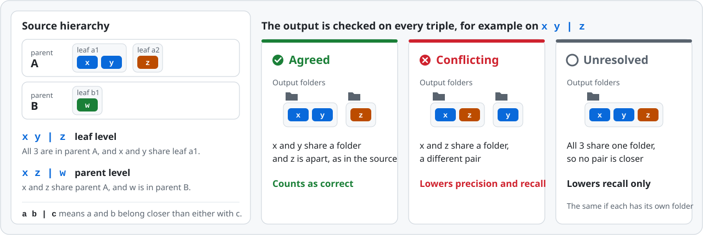

# How the Structure Score works

This page explains how InfoOrgBench scores the folder tree that an agent
leaves behind. It follows Section 4.1 and Appendices D and H of the
[paper](https://arxiv.org/abs/2611.10600), and every number on this page comes
from the released scorer,
[`benchmark/engine/scoring/structure.py`](../benchmark/engine/scoring/structure.py).
The README has a [short version](../README.md#scoring).

- [The idea in brief](#the-idea-in-brief)
- [Step 1: Check that every record is kept](#step-1-check-that-every-record-is-kept)
- [Step 2: Compare the trees on triples of records](#step-2-compare-the-trees-on-triples-of-records)
- [Step 3: Sort the triples into 2 levels](#step-3-sort-the-triples-into-2-levels)
- [Step 4: Precision and recall at each level](#step-4-precision-and-recall-at-each-level)
- [Step 5: Balance the 2 levels](#step-5-balance-the-2-levels)
- [Step 6: Folder economy](#step-6-folder-economy)
- [Step 7: From one task to a family score](#step-7-from-one-task-to-a-family-score)
- [A worked example](#a-worked-example)
- [What the score does not reward or punish](#what-the-score-does-not-reward-or-punish)
- [Other measures in the paper](#other-measures-in-the-paper)
- [Compute it yourself](#compute-it-yourself)

## The idea in brief

An output is scored only if it keeps every record exactly once and unchanged.
The score then looks at every set of 3 records. The source hierarchy says which
2 of them belong closer together, and the score measures how often the
output's folders say the same thing. It does this separately for relations
between parent groups and for relations inside a parent group, and then
lowers the result a little if the output adds folders that hold only one item:

```math
S = F_1^{\text{bal}} \times E
```

Here $`F_1^{\text{bal}}`$ measures how well the relations between records
match (steps 2 to 5), and $`E`$ is the folder-economy factor (step 6). Scores
are reported on a scale from 0 to 100.

## Step 1: Check that every record is kept

When the agent stops, the final files are captured outside the agent. The
output is **valid** when every record of the task appears exactly once and its
text is byte for byte the same as in the task. With
[`run_task.py`](../benchmark/run_task.py), extra files in the workspace also
make an output invalid. An invalid output scores 0, and that 0 stays in the
family average.

Records that the agent leaves in `inbox/` are not an error. They are scored as
if `inbox` were one more folder, which usually costs relations, because the
records in it are unlikely to belong together.

## Step 2: Compare the trees on triples of records

The scorer never compares folder names. It only asks which records end up in
the same folders. For two records $`i`$ and $`j`$ in a tree $`T`$, the
**shared depth** $`d_T(i, j)`$ is the number of folders, counted from the top,
that the paths of the two records have in common.

Now take any 3 records. If one pair shares a deeper folder than the other two
pairs, the tree **resolves** the triple, and we write the result as
`ab|c`: records a and b belong closer together than either does with c. If no
single pair is deepest, for example because all 3 records sit in the same
folder or in 3 sibling folders, the triple is **unresolved** in that tree.

For each triple that the source hierarchy resolves, the output's answer falls
into one of 3 cases:

| Case | What the output does | Effect |
| --- | --- | --- |
| **Agreed** | pairs the same 2 records as the source | counts as correct |
| **Conflicting** | pairs a different 2 records | lowers precision and recall |
| **Unresolved** | pairs no 2 records more closely than the third | lowers recall only |

<p align="center">
  <picture>
    <source media="(prefers-color-scheme: dark)" srcset="assets/metric-rule-dark.svg">
    
  </picture>
</p>

A conflict is a wrong statement, so it costs both precision and recall. An
unresolved triple is a missing statement, so it costs recall only.

## Step 3: Sort the triples into 2 levels

Every reference in InfoOrgBench has 2 levels below a shared wrapper folder:
**parent groups** (meetings, parent issues or SIGs) and **leaf groups** inside
a parent (summary sections, subtasks or proposals). Each triple belongs to the
level at which its 3 records separate in the source:

- **Parent level:** the 3 records are not all in the same parent group, for
  example 2 notes from one meeting and 1 from another.
- **Leaf level:** the 3 records share a parent group but not a leaf group, for
  example 2 excerpts from one proposal and 1 from a sibling proposal of the
  same SIG.

Formally, the level of a triple $`q`$ is the smallest shared depth among its
3 pairs in the reference $`R`$, after removing any wrapper folder that contains
every record. Level 0 is the parent level and level 1 is the leaf level.

```math
\ell_R(q) = \min_{\{i,j\} \subset q} d_R(i, j)
```

## Step 4: Precision and recall at each level

At each level $`\ell`$ the scorer counts 3 numbers:

- $`g_\ell`$: triples at this level that the **source** resolves,
- $`o_\ell`$: triples at this level that the **output** resolves,
- $`m_\ell`$: triples that both resolve the same way (agreed).

```math
R_\ell = \frac{m_\ell}{g_\ell}, \qquad P_\ell = \frac{m_\ell}{o_\ell}
```

Recall $`R_\ell`$ asks how many of the source's relations the output gets
right. Precision $`P_\ell`$ asks how many of the relations that the output
states are right. Note that $`o_\ell`$ also counts triples that the source
leaves unresolved. If 3 records come from 3 different parents in the source,
but the output puts 2 of them in one parent, the output states a relation that
the source does not have, and precision drops.

Recall uses every level that the source resolves. Precision uses the levels
where the output also resolves at least one triple. Levels deeper than any
distinction in the source never count; output relations there are reported as
**unsupported refinement** (see
[below](#what-the-score-does-not-reward-or-punish)).

## Step 5: Balance the 2 levels

Parent-level triples far outnumber leaf-level ones: in the worked example
below there are 240 parent-level triples and 20 leaf-level triples. If all
triples were pooled, the parent level would decide almost the whole score. So
the scorer first averages precision and recall over the levels, giving each
level equal weight, and then takes their harmonic mean:

```math
\bar P = \frac{1}{|L_P|} \sum_{\ell \in L_P} P_\ell, \qquad
\bar R = \frac{1}{|L_R|} \sum_{\ell \in L_R} R_\ell, \qquad
F_1^{\text{bal}} = \frac{2 \bar P \bar R}{\bar P + \bar R}
```

$`L_R`$ is the set of levels that the source resolves, and $`L_P`$ is the
subset where the output also resolves something. Every task resolves triples
at the parent level, and 148 of the 150 tasks also resolve triples at the leaf
level. A completely flat output resolves no triple, so its
$`F_1^{\text{bal}}`$ is 0.

## Step 6: Folder economy

A folder that wraps a single item keeps every relation intact but adds a
step for anyone browsing the tree. Folder economy lowers the score for such
folders when the output has more of them than the source:

```math
E = 1 - \lambda \, \frac{\max\{0,\; u(O) - u(R)\}}{n(O)}, \qquad \lambda = 0.2
```

$`u(O)`$ and $`u(R)`$ count the **single-child folders** of the output $`O`$
and the source $`R`$, that is, folders that hold exactly one item (one record
or one subfolder), and $`n(O)`$ counts the folders in the output. A wrapper
folder that contains every record is removed first, so it never counts. Only
single-child folders beyond the source's own count lower the score; some
sources have them too, for example a Thread parent issue with a single
subtask.

E never goes below 0.8. Across task families, folder economy accounts for 1%
to 10% of the gap between S and a perfect score; the rest comes from
relations. The paper also reports the **economy penalty**, $`100(1 - E)`$.

An example from the scorer: a source holds 7 records in 3 leaf groups, A/X,
B/Y and B/Z. An output that puts the records of each leaf group into one more
subfolder keeps every relation, so $`F_1^{\text{bal}}`$ remains 1. But it has
3 more single-child folders than the source (X, Y and Z now each hold only
that subfolder) among its 8 folders, so $`E = 1 - 0.2 \times 3/8 = 0.925`$.

## Step 7: From one task to a family score

S is computed for each task and then averaged; multiplying averaged parts
would give a different number. Each family score is the mean over its 50 tasks
with equal weight, invalid outputs counted as 0. The average in the results
table (Avg) is the mean of the 3 family scores, so Recap, Thread and Design
count equally.

## A worked example

This example from Appendix H of the paper contains every kind of mistake at
once. The source has 3 parents and 7 leaves with 2 records each. The agent's
output makes 4 mistakes.

<p align="center">
  <picture>
    <source media="(prefers-color-scheme: dark)" srcset="assets/metric-example-dark.svg">
    
  </picture>
</p>

One triple for each mistake shows how the cases arise:

| Mistake | Example triple | Source pairs | Output pairs | Case | Level |
| --- | --- | --- | --- | --- | --- |
| none (leaf a1 is correct) | x1, x2, y1 | x1 and x2 | x1 and x2 | agreed | leaf |
| 1. leaf a2 filed under parent B | x1, y1, z1 | x1 and y1 | y1 and z1 | conflicting | parent |
| 2. leaf a3 alone in a new parent D | x1, t1, z1 | x1 and t1 | none | unresolved | parent |
| 3. leaves c1 and c2 merged | u1, u2, v1 | u1 and u2 | none | unresolved | leaf |
| 4. record z2 moved into the merged leaf | z1, z2, u1 | z1 and z2 | z2 and u1 | conflicting | parent |
| 4. record z2 moved into the merged leaf | z1, z2, w1 | z1 and z2 | z1 and w1 | conflicting | leaf |

Over all triples:

| Level | Agreed | Conflicting | Unresolved | Precision | Recall |
| --- | :---: | :---: | :---: | :---: | :---: |
| Parent | 104 | 42 | 94 | 104 / 194 = 0.54 | 104 / 240 = 0.43 |
| Leaf | 14 | 2 | 4 | 14 / 16 = 0.88 | 14 / 20 = 0.70 |
| Average | | | | 0.71 | 0.57 |

The parent-level precision divides by 194, not by 104 + 42 = 146, because the
output also pairs up 48 triples whose records sit in 3 different parents in
the source (step 4). Then:

- $`F_1^{\text{bal}} = 2 \times 0.71 \times 0.57 / (0.71 + 0.57) = 0.63`$
- The output has 10 folders, and 4 of them hold a single item: A, b1, C and
  D. The source has none, so $`E = 1 - 0.2 \times 4/10 = 0.92`$.
- $`S = 0.63 \times 0.92 = 0.578`$, reported as **57.8**.

The pooled Triplet F1 of this output is 50.2: pooling lets the 240
parent-level triples outweigh the 20 leaf-level ones.

## What the score does not reward or punish

- **Folder names and order.** Only which records share folders matters, so
  renaming or reordering folders changes nothing. A wrapper folder around all
  records also changes nothing.
- **Splitting a group more finely than the source.** The score rewards the
  relations that the source states. In the paper's example (Appendix D.3),
  the source has records a, b and c in folder A/X, d and e in B/Y, and f and
  g in B/Z. An output that splits A/X into A/X1 with a and b and A/X2 with c
  keeps every relation that the source resolves, so it scores 100. The
  relation between a, b and c lies at a level that the source does not
  resolve and is reported as unsupported refinement. Nesting part of a leaf
  group one level deeper also leaves the score unchanged. Clade F1 (below)
  detects such splits.
- **Flat outputs.** Filing every record into one folder states no relation,
  so it scores 0. In the paper, 3 Recap outputs of MAI-Code-1.1-Flash with
  Deep Agents did this.
- **How useful a tree is to a person.** The score measures agreement with
  the source hierarchy. Whether people find a tree easy to navigate is a
  separate question that the benchmark does not test.

## Other measures in the paper

| Measure | What it adds | Where to find it |
| --- | --- | --- |
| **Pooled Triplet F1** | F1 over all triples without balancing the levels: $`2\sum_\ell m_\ell \,/\, (\sum_\ell g_\ell + \sum_\ell o_\ell)`$ | Table 3; `pooled_triplet_f1` in [results/per-task.csv](../results/per-task.csv) |
| **Economy penalty** | $`100(1 - E)`$, the points lost to single-child folders | Table 3; `folder_economy` in results/per-task.csv |
| **Parent and leaf recall** | $`R_\ell`$ for each level, to see where the relations are lost | `run_task.py score`; the `level_0_*` (parent) and `level_1_*` (leaf) counts in results/per-task.csv, where available |
| **Clade F1** | compares complete groups instead of relations: $`2k / (\lvert C_O \rvert + \lvert C_R \rvert)`$, where $`C_T`$ holds the record set of every folder except single records and the full collection, and $`k`$ counts the sets shared by both trees | Table 10; `clade_f1` in results/per-task.csv, where available |
| **Exact recovery** | whether the output reproduces the source tree exactly, up to names and order | Table 10; `exact_tree` in results/per-task.csv and in the `result.json` of `run_task.py` |

**Relations versus complete groups.** Agreeing on most relations does not mean
recovering whole groups. With ReAct-FC, GPT-6.1 Sol scores 74.1 on Recap and
77.9 on Thread, but its clade F1 is 35.1 and 36.1, and it reproduces the
source tree exactly in 1 and 2 of the 50 tasks. Claude Haiku 4.5 scores 40.8
and 46.2, with clade F1 of 1.7 and 8.6 and no exact recovery. On Design,
GPT-6.1 Sol recovers 30 of the 50 hierarchies exactly.

**Errors by level.** Counting agreed, conflicting and unresolved triples at
each level shows where outputs go wrong (Table 13 of the paper; medians over
the systems with per-level data):

| Family | Parent level: agreed / conflicting / unresolved | Leaf level: agreed / conflicting / unresolved |
| --- | :---: | :---: |
| Recap (meeting, section) | 0.38 / 0.35 / 0.27 | 0.46 / 0.36 / 0.18 |
| Thread (issue, subtask) | 0.40 / 0.07 / 0.54 | 0.68 / 0.09 / 0.22 |
| Design (SIG, proposal) | 0.87 / 0.02 / 0.12 | 0.99 / 0.00 / 0.01 |

Recap errors are mostly conflicts: agents group notes by topic instead of by
meeting. Thread errors are mostly unresolved: agents often leave out the
parent-issue level.

**Choice of λ.** Because E changes linearly with λ, setting λ to 0 or
doubling it to 0.4 changes a family score by at most its economy penalty in
Table 3. That penalty is at most 5 points in every Recap cell and in all but
one Design cell, but exceeds 5 points in 29 of the 45 Thread cells, where λ
matters most. For the silhouette baseline, λ = 0 and λ = 0.4 give 28.7 and
25.1 on Recap, 37.2 and 30.8 on Thread, and 73.9 and 68.1 on Design, against
26.9, 34.0 and 71.0 at λ = 0.2.

## Compute it yourself

To score a run folder, use `run_task.py` as in the
[Quick start](../README.md#quick-start):

```bash
cd benchmark
python run_task.py score ../../runs/recap-001
```

It prints the Structure Score, the pooled Triplet F1, the economy penalty and
the recall at each level, and saves them to `result.json`.

To score any two trees directly, pass a mapping from record ID to folder path
to `structure_metrics`. This script reproduces the worked example; run it from
the repository root:

```python
import sys
sys.path.insert(0, "benchmark/engine")
from scoring.structure import structure_metrics

# Source: parents A, B and C; every leaf holds 2 records, for example x1 and x2 in leaf a1.
leaves = {"a1": ("A", "x"), "a2": ("A", "y"), "a3": ("A", "t"), "b1": ("B", "z"),
          "b2": ("B", "w"), "c1": ("C", "u"), "c2": ("C", "v")}
reference = {f"{r}{i}": (parent, leaf) for leaf, (parent, r) in leaves.items() for i in (1, 2)}

output = dict(reference)
output.update({"y1": ("B", "a2"), "y2": ("B", "a2"),   # mistake 1: leaf a2 under parent B
               "t1": ("D", "a3"), "t2": ("D", "a3")})  # mistake 2: leaf a3 alone in parent D
for record in ("u1", "u2", "v1", "v2", "z2"):          # mistakes 3 and 4: merged leaf, moved z2
    output[record] = ("C", "c1+c2")

m = structure_metrics(output, reference)
print(f"S = {100 * m['structure_score']:.1f}")         # S = 57.8
for row in m["levels"]:
    print(row["level"], row["agreed"], row["conflicting"], row["output_unresolved"])
```

The result also holds `level_balanced_triplet_f1`, `level_precision`,
`level_recall`, `folder_economy`, `pooled_triplet_f1` and the counts for each
level.
